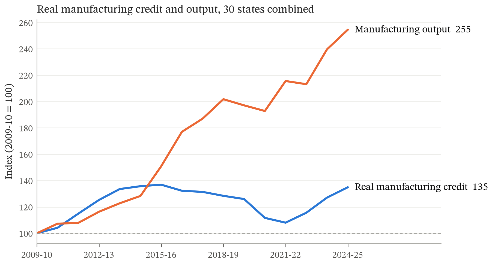
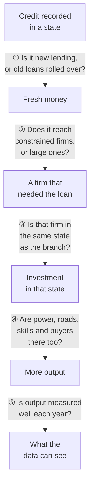

# Does Bank Credit Build Factories?

**A 15-year test of a core assumption of Indian industrial policy: that lending more to manufacturers makes them produce more.**

`33 states and UTs` · `FY2009-10 to FY2024-25` · `2 million+ district-level loan records` · `9 RBI datasets` · `1 uncomfortable answer`



> Between 2009-10 and 2024-25, India's real manufacturing output grew **2.5 times**. Real bank credit to manufacturing rose until 2015-16, then **declined for six years**, and ended only 1.35 times where it began. Factories kept producing more while their bank credit shrank.
>
> This repository asks whether that is a coincidence of one decade or a sign of something deeper.

---

### Read this in…

**30 seconds:** [The answer](#the-answer) · **5 minutes:** [Guess first](#guess-first) → [The vanishing effect](#the-vanishing-effect) → [What it says about the theory](#what-the-number-says-about-the-theory) · **30 minutes:** [Trying to break the result](#trying-to-break-my-own-result) → [Where the chain breaks](#where-the-chain-from-credit-to-output-breaks) → [the paper](#data-method-and-code)

---

## The answer

Compare each state with itself over time, and remove what hit all of India in a given year. Then **more manufacturing credit is not followed by more manufacturing output.**

- The best estimate of the effect is **−0.075**, which is statistically indistinguishable from zero (wild bootstrap *p* = 0.48).
- The data rule out anything above **+0.12**: a 10% rise in credit goes with at most a 1.2% rise in output.
- States that started out short of credit, where the effect should have been largest, show the **smallest** estimates.

---

## Guess first

Here is a true fact from the data. Across Indian states, **a state with 10% more manufacturing credit has about 8% more manufacturing output.** The relationship is strong and highly significant.

So how much of that 8% is credit *causing* output?

<details>
<summary><b>Make a guess, then click to reveal</b></summary>

<br>

**Essentially none.** Once you stop comparing Maharashtra with Mizoram and booming years with slow ones, nothing is left. The next section shows exactly where the 8% goes.

If you guessed "about half", you made a very common mistake. Size and shared trends can produce a correlation that looks causal on its own.

</details>

---

## The vanishing effect

Here is the same regression, with one more source of unfair comparison removed at each step:

```
                                        credit elasticity
Pooled: all states, all years           ████████████████████████████████▉  0.82 ***
+ compare each state only to itself     ██████████▎                        0.26 *
+ remove India-wide shocks each year    ▏                                 −0.02
+ hold state income level fixed         ▏                                 −0.08   ← main estimate
```

| Step | What it removes | Why it matters |
|---|---|---|
| State fixed effects | Permanent differences between states | Maharashtra has more banks *and* more factories than Mizoram for reasons unrelated to lending: size, ports, history |
| Year fixed effects | Shocks that hit every state at once | In a good year for India, credit and output both rise everywhere: monetary policy, demand, the business cycle |
| Lagged income | A state's level of development | Richer states may borrow more *and* produce more simply because they are richer |

The data never changed, only *what was compared with what*. This is the single most transferable lesson in this repository.

---

## What the number says about the theory

The paper starts from a textbook model. Firms produce with $Y = AK^{\alpha}L^{1-\alpha}$, and a credit-constrained firm can buy only as much capital as its loan allows, so $K \le \lambda \cdot \text{Credit}$. Adding up all the firms in a state gives a clean prediction:

$$\frac{\partial \ln Y_s}{\partial \ln \text{Credit}_s} = \alpha \cdot \theta_s$$

Here $\theta_s$ is **the share of a state's output that comes from credit-constrained firms**, and $\alpha$ is how much output responds to capital.

This turns a regression estimate into a statement about the economy. Take a standard capital share of $\alpha \approx 1/3$. The upper confidence limit then caps the share of output that could be coming from constrained firms:

| Sample | Upper limit on the effect | Implied ceiling on θ |
|---|---:|---:|
| Full period | 0.12 | at most **~36%** of manufacturing output |
| After 2015-16 | 0.05 | at most **~15%** of manufacturing output |

If Indian manufacturing were mostly made up of firms waiting for a loan, the estimate would be far larger. The data are inconsistent with that picture *at the state level and with credit measured as a stock*. They are consistent with a smaller constrained sector, or with credit that mostly does not reach it.

---

## The twist in H2

The theory says one more rupee matters most where rupees are scarce. So the credit-scarce states really are more constrained, on every measure available:

| | Credit-scarce third | Credit-rich third |
|---|---:|---:|
| Average manufacturing loan | ₹8.1 lakh | ₹61.4 lakh |
| Share of credit in small loans | 48% | 10% |
| Share of the credit limit actually used | 72% | 58% |
| **Estimated effect of credit on output** | **−0.16** | **+0.11** |

They are the most credit-starved, yet their output responds to credit the least. The difference is not statistically significant, but it points the wrong way for the theory. A natural reading is that credit is a **complement**, not a substitute: a loan for a machine pays off only with reliable power, roads, skilled workers and buyers, and those are scarcer in the same states.

---

## Trying to break my own result

A null result is only as good as the attacks it survives. Each row below is an objection a skeptic, or an actual reviewer, raised against this result:

| The objection | The test | What happened |
|---|---|---|
| *"Effects take time to show up."* | Credit lagged 2 and 3 years, averaged, and summed over 3 years | Every estimate is negative (−0.16 to −0.22). None is positive. |
| *"The 2015 bad-loan clean-up hid the effect."* Write-offs cut credit while factories kept running. | Estimate before and after the clean-up separately | **Before: −0.29.** After: −0.06, ruling out anything above 0.05. No effect before the crisis either. |
| *"Slow changes inside a state drive it,"* such as new highways, power plants or industrial policy. | A separate linear and quadratic trend for every state | −0.15 and −0.16. The upper confidence limit falls to **zero**. |
| *"Your standard errors are too optimistic with only 33 states."* | Wild cluster bootstrap, 1,999 replications | This test is why one H2 result went from \*\*\* to *p* = 0.26 |
| *"Output drives credit, not the other way round."* | Panel Granger and Dumitrescu-Hurlin tests | No predictive link **in either direction** |
| *"Use a dynamic panel model."* | System GMM and Difference GMM | System GMM finds +0.22, but its extra instruments fail the difference-in-Hansen test, and the estimate disappears with deeper lags. Not credible. |
| *"Maharashtra and Delhi distort it,"* because loans are booked at head offices. | Drop them, and drop the top 3 by credit depth | Unchanged |
| *"COVID years are special."* | Drop 2020-21 and 2021-22 | −0.08, unchanged |
| *"Small borrowers are what matter."* | Credit in small loans and from rural banks | **The one consistently positive signal** (+0.035 and +0.07). It is never significant, and effects above 0.09 are ruled out. |

---

## Where the chain from credit to output breaks

For a rupee of recorded credit to become a rupee of factory output, every link below must hold. The data suggest several are weak.



| Link | Evidence from this project |
|---|---|
| ① | The data record the balance outstanding on 31 March, which includes working capital, rolled-over and stressed loans. Credit declined for six years while output rose. |
| ② | In credit-rich states, only 10% of manufacturing credit is in small loans |
| ③ | Credit is booked at the lending branch. Chandigarh and Delhi show credit-to-GSDP ratios above 1.5. |
| ④ | The most credit-starved states respond the least (see [the twist](#the-twist-in-h2)) |
| ⑤ | State manufacturing output is partly estimated by allocating national totals |

---

## Five things this project taught me

1. **A correlation of 0.82 can be zero in disguise.** Nothing about the data changed, only the comparison.
2. **Read the variable before the regression.** "Credit" here is a 31 March balance, not money spent on factories. Every result depends on that detail.
3. **Thirty-three is a small number.** With few clusters, conventional standard errors can turn noise into significance stars.
4. **Passing a test is not the same as being right.** System GMM passed the usual AR(2) and Hansen checks and still did not hold up.
5. **A well-defended "no" is a finding.** Ruling out large effects tells policymakers something the positive-sounding correlation never could.

## What would change my mind

- **Data on new loans**, not balances, recorded by **where the borrowing factory is**, not where the bank branch is.
- **Firm-level links** between loans and production, showing credit-constrained firms expanding without that showing up in state totals.
- **A policy shock to credit** that hits some states and not others, for a cleaner natural experiment than year-to-year variation.

---

## Data, method and code

<details>
<summary><b>Data: 9 public RBI tables</b></summary>

<br>

All data are from the Reserve Bank of India's [Database on Indian Economy (DBIE)](https://dbie.rbihub.in/statistics).

| # | DBIE table | Used for |
|---|---|---|
| 1 | [Bank credit of SCBs: bank group, population group, occupation, district-wise](https://dbie.rbihub.in/statistics?table=financial_sector.r1222_bank_credit_of_scbs_bank_group_population_group_occupatio) (BSR-1) | Manufacturing credit, accounts, limits, small-ticket and grassroots credit |
| 2 | [Components and economic activity of domestic product, state-wise](https://dbie.rbihub.in/statistics?table=real_sector.comp_eco_act_nsdp_fact_cst_rn) | Manufacturing output (net state value added, constant prices) |
| 3 | [Gross state domestic product](https://dbie.rbihub.in/statistics?table=real_sector.gross_state_dom_prd_rn) | Initial credit depth (credit / GSDP) |
| 4 | [Per capita net state domestic product](https://dbie.rbihub.in/statistics?table=real_sector.per_cap_net_sdp_rn) | Income control and state price deflator |
| 5 | [Loans and advances of SCBs, state and occupation-wise (BSR-1)](https://dbie.rbihub.in/statistics?table=financial_sector.lna_scb_sr_occ_bsr1_a_rn) | Checking the units of the district credit data |
| 6 | [CPI: rural, urban, combined (state-wise)](https://dbie.rbihub.in/statistics?table=real_sector.cpi_ruc_st_rn) | Alternative deflator |
| 7 | [Annual Survey of Industries](https://dbie.rbihub.in/statistics?table=real_sector.ann_surv_inds_rn) | Context on registered factories |
| 8 | [Important banking indicators: regional rural banks](https://dbie.rbihub.in/statistics?table=financial_sector.r331_important_banking_indicators_regional_rural_banks_outstand) | Grassroots lending context |
| 9 | [Self-help group bank linkage programme](https://dbie.rbihub.in/statistics?table=financial_sector.r338_self_help_group_bank_linkage_programme) | Grassroots lending context |

**Panel:** 33 states and UTs, 519 state-years (486 with lagged credit).

**Cleaning choices:**
- Older output series are spliced backwards onto the 2011-12 base.
- Andhra Pradesh starts in 2013-14, so its territory excludes Telangana throughout.
- 34 state-years with implausible jumps are flagged, not deleted, and tested separately.

</details>

<details>
<summary><b>Method</b></summary>

<br>

**Main specification:**

$$\ln Y_{s,t} = \beta_1 \ln \text{Credit}_{s,t-1} + \gamma \ln y_{s,t-1} + \mu_s + \tau_t + \varepsilon_{s,t}$$

- $\mu_s$ is a state fixed effect, $\tau_t$ a year fixed effect, and $y$ income per person.
- Credit is lagged one year, because a machine bought this year produces next year.
- H1 predicts $\beta_1 > 0$.

**H2** adds an interaction with each state's credit depth in its first year (credit / GSDP), centred at the average. States are also split into thirds by that depth.

**Small-borrower proxies.** The data do not label firms by size, so two proxies are used:
- **Small-ticket credit:** loans in cells averaging at most ₹25 lakh per account.
- **Grassroots credit:** loans from regional rural, small finance and local area banks, or from rural and semi-urban branches.

**Inference.** Standard errors are clustered by state. Headline *p*-values come from a wild cluster bootstrap (Rademacher weights, null imposed, 1,999 replications). Driscoll-Kraay standard errors are a further check.

**GMM.** Two-step System and Difference GMM with collapsed instruments and Windmeijer-corrected standard errors. The estimator was written from scratch and validated by simulation.

</details>

<details>
<summary><b>Analysis steps and how to reproduce</b></summary>

<br>

| Step | What it does |
|---|---|
| 1–2 | Research question, hypotheses and derivation |
| 3 | Merge the 9 files into `master_dataset.csv`, clean, flag jumps, build `analysis_panel.csv` |
| 4 | Descriptive charts and tables (`figures/`) |
| 5 | H1: main regressions and 12 diagnostic specifications |
| 6 | H2: interaction, terciles and leverage checks |
| 7 | Small-ticket and grassroots credit |
| 8 | Reverse causality: Granger, Dumitrescu-Hurlin, System and Difference GMM |
| 9 | Robustness: drop Maharashtra and Delhi, growth rates, total credit, drop COVID years |
| 10 | Before vs after the 2015 bad-loan clean-up |
| 11 | State-specific linear and quadratic trends |

```bash
pip install pandas numpy scipy linearmodels statsmodels matplotlib
```

1. Download the nine tables above from DBIE as CSV files and put them in the same folder as the notebook.
2. Run the cells in order. Each step reads the output of the one before it.

Python 3.10+ is required.

</details>

---

## Limitations, briefly

- **What the design can and cannot rule out:** it rules out large effects, not small ones.
- **Stocks, not flows:** credit is measured as a stock, not as new lending.
- **Firm size is proxied:** the small-borrower measures stand in for firm size, which the data do not record.
- **Not every shock is removed:** fixed effects and state trends cannot remove every one-off, state-specific shock.

None of this says credit does not matter to an individual firm. Firm-level studies in India find that it does. The finding is narrower and, for state-level policy, more useful: **growth in the stock of bank credit has not shown up in state manufacturing output.**

---

**Priyansh**, Ahmedabad University · Questions and corrections welcome via GitHub issues.

> Priyansh (2026). *Does Bank Credit Build Factories? Evidence from Indian States, 2009-10 to 2024-25.* Working paper, Ahmedabad University.